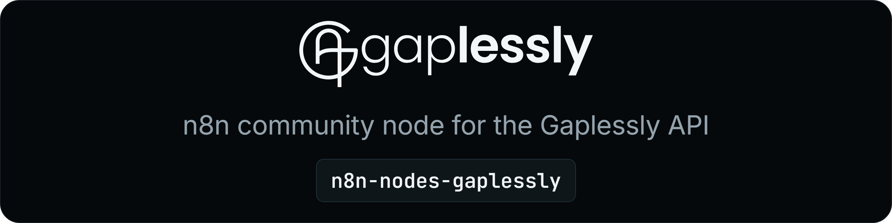

<a href="https://gaplessly.com/docs/integrations"></a>

<p align="center">
  <a href="https://www.npmjs.com/package/n8n-nodes-gaplessly"></a>
  <a href="https://github.com/gaplessly/n8n-nodes-gaplessly/actions/workflows/ci.yml"></a>
  
  <a href="./LICENSE"></a>
</p>

Automate your own [Gaplessly](https://gaplessly.com) account in [n8n](https://n8n.io): bookings, availability, guests, tables, till checks and walk-ins, plus an instant trigger for booking, guest and till check events. Every endpoint of the Gaplessly API, for both kinds of business: table reservations (restaurants, bars) and appointments (salons and other appointment businesses). The node reads which one your account is and sends the right request.

## Install

In n8n, open **Settings > Community nodes > Install** and enter:

```
n8n-nodes-gaplessly
```

Or follow n8n's [community nodes installation guide](https://docs.n8n.io/integrations/community-nodes/installation/). Tested on n8n 2.46.

## Credentials

1. In Gaplessly, open **Developer** ([app.gaplessly.com/developer](https://app.gaplessly.com/developer)) and create an API key. Start with **Test (sandbox)**: a test key reaches a private sandbox copy of your setup, never your real bookings, and sends no guest emails or texts.
2. Tick only the scopes the workflow needs (table below).
3. In n8n, create a **Gaplessly API** credential and paste the key. n8n checks it against your organization.

Switch to a live key once the workflow does what you expect.

## Nodes

### Gaplessly

| Resource | Operations | Scope |
|---|---|---|
| Availability | Check free times for a local date, party size or service and staff member | `availability:read` |
| Booking | Create, Update (time, party size, notes), Cancel, Get Many (a local date range) | `reservations:*` or `appointments:*` |
| Booking, table reservations only | Update Status (seated, completed, no-show, undo a seat), Move Table, Seat Walk-In, Record Check, Get Checks | `reservations:write` / `:read` |
| Event | Get a booking, guest or till check event by its ID, as Gaplessly sent it | `webhooks:write` + the event's read scope |
| Guest | Find (by email, or phone compared by digits), Get Many | `clients:read` |
| Organization | Get | `organization:read` |
| Service, Staff Member | Get Many (appointments) | `services:read`, `providers:read` |
| Table, Service Period | Get Many (table reservations) | `tables:read`, `service-periods:read` |

Every key also needs `organization:read`, which the node uses to tell the two kinds of business apart. Asking a table-only operation of an appointments business fails before any request is sent.

### Gaplessly Trigger

Starts a workflow when a booking is created, updated or cancelled, a guest is created or merged, or (table reservations) a till check opens or changes. Activating the workflow registers a webhook on your account; deactivating it removes it. Needs `webhooks:write` and the read scope for the events you pick.

## Usage

- **Local times.** Enter start times in the business's own local time, `YYYY-MM-DDTHH:MM`, with no UTC offset. Pick one from **Availability > Check**. Times in results carry the venue's offset.
- **Retries never double-book.** **Booking > Create** and **Seat Walk-In** take a **Source Event ID**: a stable ID from whatever started the booking, such as a form submission or a till event. Running the node again with the same ID returns the first booking instead of making a second. Use a new ID for each booking you intend.
- **Payment rules hold.** If a booking needs a deposit or a card, nothing is booked. The node fails with a link the guest can use to finish online.
- **Booking ID or event ID.** In a trigger payload the booking is `data.object.id`; the top-level `id` is the event.
- **Errors** carry Gaplessly's own message and code, such as `insufficient_scope` when the key lacks a scope.

## Examples

- **Tell the manager about a large party.** Gaplessly Trigger (Booking Created) → IF `{{$json.data.object.partySize}}` is larger than 7 → Send Email.
- **Book from a form.** Form Trigger → Gaplessly (Availability > Check) → Gaplessly (Booking > Create), with Source Event ID set to the form submission's ID.
- **Keep a sheet of bookings.** Gaplessly Trigger (Booking Created, Updated, Cancelled) → Google Sheets (Append or Update Row, matched on `data.object.id`).
- **Send till totals.** Your POS webhook → Gaplessly (Booking > Record Check) with the till's check number, so guest spend shows in Gaplessly.

## Security

- Every event is signed (`Gaplessly-Signature`, HMAC-SHA256 over the raw body). The trigger refuses anything unsigned, altered or more than five minutes old, and runs each event once even when Gaplessly retries it.
- The API key is stored as an n8n credential and sent only to `gaplessly.com`, in the `Authorization` header.
- No runtime dependencies and no telemetry.
- Releases are built from this repository by GitHub Actions, with [npm provenance](https://docs.npmjs.com/generating-provenance-statements), and staged: a new version goes live only after a maintainer approves it with two-factor authentication.

Found a security issue? Email [hello@gaplessly.com](mailto:hello@gaplessly.com) rather than opening a public issue.

## Links

- [Integrations guide](https://gaplessly.com/docs/integrations)
- [API reference](https://gaplessly.com/docs) and the [OpenAPI 3.1 document](https://gaplessly.com/openapi.json)
- [Gaplessly CLI](https://github.com/gaplessly/cli) and [MCP server](https://gaplessly.com/docs/mcp)
- [n8n community nodes documentation](https://docs.n8n.io/integrations/#community-nodes)

## Version history

See [CHANGELOG.md](./CHANGELOG.md).

## Licence

[MIT](./LICENSE)
